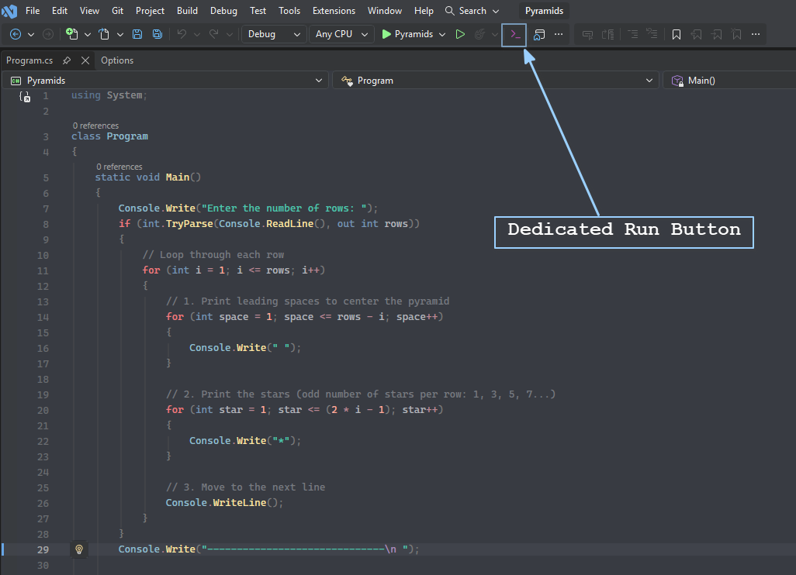
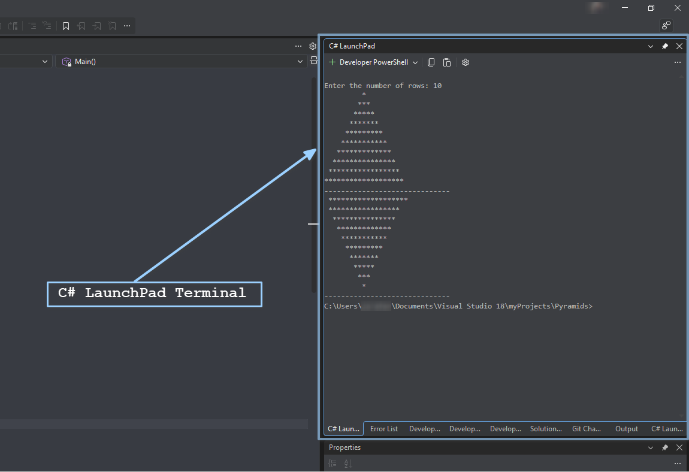

# C# Inline LaunchPad

A lightweight Visual Studio extension that brings JetBrains Rider-style inline execution to C# console projects. Run your program with one click and see its output in a terminal pane inside the IDE, instead of in a separate console window.

## Features
* **Toolbar Execution & Auto-Save Toggle:** Run active Console projects directly from the main toolbar. Includes a dedicated button to toggle auto-saving files before execution from tools menu.
* **Integrated Terminal Pane:** Embeds standard input and output inside native terminal pane instead of  `cmd.exe` pop-ups.
* **`Alt + F5` Hotkey:** .
* **Interactive Standard I/O:** Full support for `Console.ReadLine()`, `Console.ReadKey()`, and real-time terminal interaction.
* **Process Lifecycle Control:** Automatically reuses terminal tabs and cleanly terminates active background processes to prevent file-lock errors.
* 
| Toolbar Launch Button | Integrated Terminal Output |
| :---: | :---: |
|  |  |
| *Toolbar integration* | *Interactive terminal execution* |

## Installation

1. Download the `.vsix` installer from the [Releases](https://github.com/jafar-alshishani/CSharpInlineLaunchPad/releases) tab or the [Visual Studio Marketplace](https://marketplace.visualstudio.com/items?itemName=jafar-alshishani.csharp-inline-launchpad).
2. Double-click `CSharpInlineLaunchPad.vsix` to install.
3. Restart Visual Studio.

## Requirements

* Visual Studio 2026 (tested), or Visual Studio 2022 with the integrated Terminal window (installable; not yet tested)
* A .NET SDK (.NET 6+), or a .NET Framework 4.x console project

## Tested on

* Visual Studio 2026 with SDK-style (.NET) console projects
* .NET Framework 4.6.2 console projects

## Known limitations
- Open Folder mode (a folder opened without a solution or project) is not supported yet. Open the `.sln`, `.slnx` or `.csproj` file instead.
* The program runs without the debugger attached, like Ctrl+F5. Use the normal Start Debugging command for breakpoints.
* Visual Studio 2022 is allowed by the installer but has not been tested at runtime.
* Legacy projects with a non-default output folder (for example `bin\x64\Debug`) are not yet supported.
* Multi-target projects, VB.NET, F# and C++ projects are not yet supported.

## Feedback

Found a problem or have an idea? Please [open an issue](https://github.com/jafar-alshishani/CSharpInlineLaunchPad/issues).

## License

Distributed under the [MIT License](LICENSE.txt).